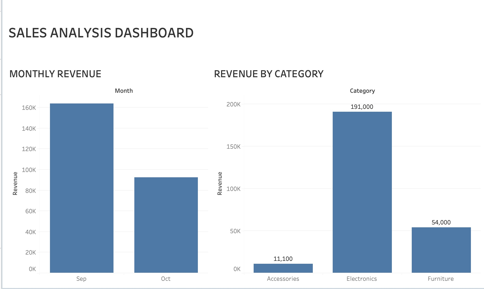

# Sales Analysis Dashboard

## Project Overview
This project analyzes sales data to identify revenue trends across months and product categories using Excel and Tableau.

## Tools Used
- Microsoft Excel
- Tableau

## Dashboard Preview

## Key Insights
- Total revenue analyzed: ₹2,51,900
- Electronics generated the highest revenue.
- Monthly revenue was compared across September and October.
- Revenue by product category was visualized to support business insights.

## Skills Demonstrated
- Data analysis
- Data visualization
- Revenue analysis
- Dashboard creation
- Business insights

## Project Files
- `sales-dashboard.jpg` — Dashboard screenshot
